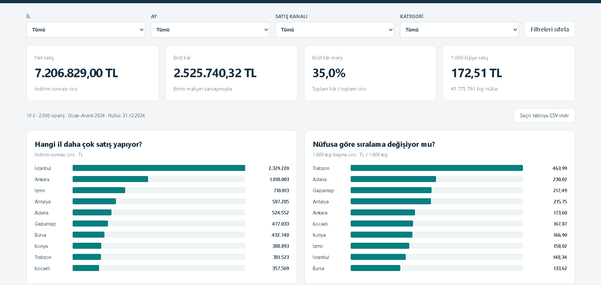
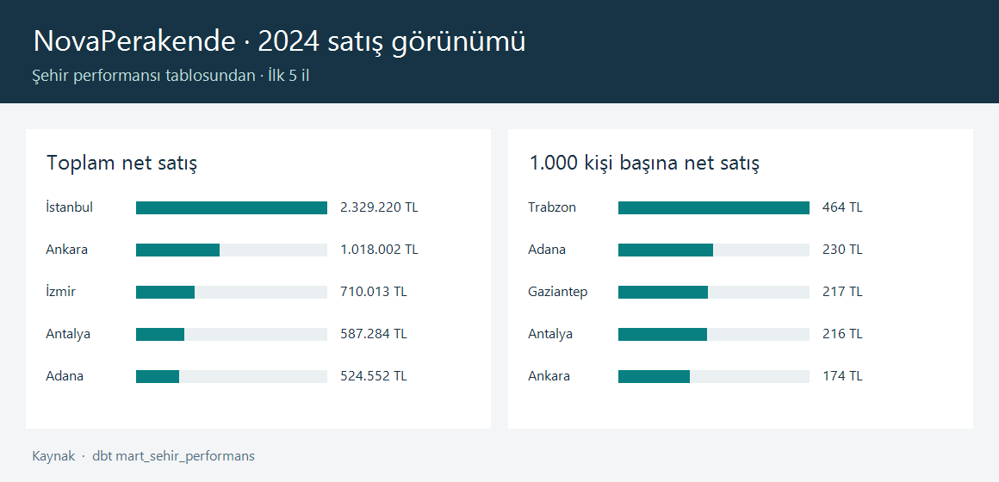
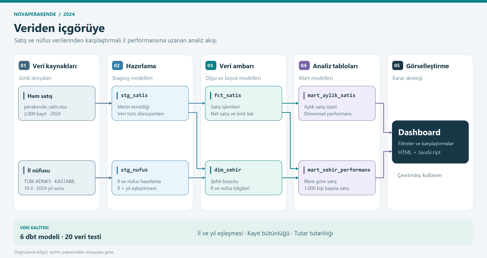
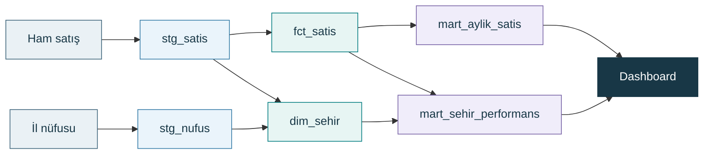

<a id="baslangic"></a>

<div align="center">

# NovaPerakende

### Nüfus ve Satış Performansı

**Satış hacminden kişi başına performansa: 10 ilin karşılaştırmalı analizi.**


**YBS305 · İş Zekâsı ve Veri Madenciliği**  
Dönem Projesi · Bölüm 1 (Vize) · 2026–2027 Güz

[Bulgular](#bulgular) · [Dashboard](#dashboard) · [Veri akışı](#veri-akisi) · [Kurulum](#kurulum) · [Ekip](#ekip)

</div>

---

<a id="proje"></a>

## 🎯 Projenin amacı

**NovaPerakende 2024’te en çok hangi illerde satış yaptı? İl nüfusları hesaba katıldığında sıralama nasıl değişiyor?**

Bu proje, 10 ilin toplam net satışını ve **1.000 kişi başına net satışını** karşılaştırır. Satış kayıtları, 2024 il nüfuslarıyla birleştirilerek illerin hem satış hacmi hem de nüfusa göre performansı incelenir.

| Analiz dönemi | Veri kapsamı | Veri modeli | Sunum |
| :--- | :--- | :--- | :--- |
| Ocak–Aralık **2024** | **10 il · 2.000 satış kaydı** | **6 dbt modeli · 20 veri testi** | Filtrelenebilir, çevrimdışı dashboard |

<a id="bulgular"></a>

## 📊 Öne çıkan sonuçlar

| Toplam net satış | Brüt kâr | Brüt kâr marjı |
| :---: | :---: | :---: |
| **7.206.829,00 TL** | **2.525.740,32 TL** | **%35,05** |

| Gösterge | Öne çıkan il | Yorum |
| :--- | :--- | :--- |
| **Toplam net satış lideri** | İstanbul | Toplam satış tutarında ilk sırada. |
| **1.000 kişi başına net satış lideri** | Trabzon | Nüfusa göre hesaplanan satışta ilk sırada. |
| **Temsil endeksi: 0,77** | Bursa | Satış payı, incelenen iller içindeki nüfus payının altında. |

> **Temel çıkarım:** Toplam satış liderliği ile nüfusa göre performans liderliği farklı illere aittir. İki göstergeyi birlikte değerlendirmek, il karşılaştırmasını daha anlamlı hâle getirir.

<a id="dashboard"></a>

## 🖥️ Dashboard

**İl, ay, satış kanalı ve ürün kategorisi** filtreleriyle sonuçları inceleyebilir; net satış, brüt kâr ve nüfusa göre satış göstergelerini aynı ekranda karşılaştırabilirsiniz.



<details>
<summary><strong>İlk 5 ilin karşılaştırmalı satış özetini göster</strong></summary>



</details>

> **Hızlı açılış:** `04-dashboard.zip` dosyasını çıkarın ve `dashboard/dist/index.html` dosyasını tarayıcıda açın. `index.html`, `app.js` ve `data.js` aynı klasörde bulunmalıdır. Dashboard çevrimdışı çalışır.

<a id="veri-akisi"></a>

## 🔄 Veri akışı ve model yapısı

Ham satış ve nüfus verileri önce hazırlanır; boyut ve satış tablolarından analiz tabloları oluşturulur. Dashboard, bu analiz tablolarının çıktılarını kullanır.



[Akış şemasının vektörel sürümünü aç](docs/gorseller/dbt-veri-akisi.svg)

<details>
<summary><strong>Model bağlantılarını Mermaid olarak görüntüle</strong></summary>



</details>

<a id="veri-ve-metrikler"></a>

## Veri kaynakları ve metrikler

### Kaynaklar

| Kaynak | İçerik | Proje içindeki konum |
| :--- | :--- | :--- |
| **Ders satış verisi** | 2024 yılına ait 2.000 satış kaydı | `data/raw/perakende_satis.xlsx` |
| **TÜİK ADNKS 2024** | KASTABİL üzerinden alınan il nüfusları | Yerel kopya ve kaynak bilgisi: `data/external/` |

### Metrik tanımları

| Metrik | Hesaplama | Açıklama |
| :--- | :--- | :--- |
| **Net satış** | `Adet × Birim fiyat × (1 − İndirim oranı)` | İndirim sonrası satış tutarı. |
| **1.000 kişi başına net satış** | `İlin net satışı ÷ 2024 il nüfusu × 1.000` | İllerin nüfusa göre satış performansı. |
| **Brüt kâr** | `Net satış − Toplam maliyet` | Kaynaktaki `Maliyet` alanı **birim maliyet** kabul edilir. |
| **Brüt kâr marjı** | `Brüt kâr ÷ Net satış × 100` | Brüt kârın net satışa oranı. |
| **Temsil endeksi** | `İlin satış payı ÷ İlin nüfus payı` | Paylar, incelenen illerin toplamına göre hesaplanır; **1**, iki payın eşit olduğunu gösterir. |

### Veri hazırlama kuralları

- **`stg_satis`** metin alanlarının başındaki ve sonundaki boşlukları kaldırır; tarih, adet, fiyat, maliyet ve indirim alanlarını uygun veri türlerine dönüştürür.
- **`stg_nufus`** il ve nüfus alanlarını analize hazırlar. Satış ve nüfus verileri **il ve yıl** üzerinden eşleştirilir.
- Kaynak satış satırlarının **tamamı** satış tablosuna aktarılır. **Negatif brüt kârlı 32 kayıt** analize dahildir.

### Veri kalitesi ve dbt testleri

Teslim paketindeki doğrulama sonuçlarına göre **6 dbt modeli ve 20 veri testi başarıyla çalışmıştır**. Kontroller şu alanları kapsar:

| Kontrol alanı | Doğrulanan özellik |
| :--- | :--- |
| **Eşleştirme** | İl ve yıl bilgilerinin tutarlılığı |
| **Alan geçerliliği** | Satış ve nüfus alanlarının geçerli olması |
| **Kayıt bütünlüğü** | Kaynak satır sayısının korunması |
| **Tutar tutarlılığı** | Analiz tablolarındaki tutarların satış tablosuyla uyuşması |

<a id="paketler"></a>

## 📦 Teslim paketleri

| Paket | İçerik |
| :--- | :--- |
| [**01 · Veri kaynakları**](01-veri-kaynaklari.zip) | `data/raw/`, `data/external/` ve veri hazırlama betikleri |
| [**02 · dbt staging**](02-dbt-staging.zip) | `stg_satis`, `stg_nufus`, dbt yapılandırması ve veri testleri |
| [**03 · Mart ve analiz**](03-mart-analiz.zip) | `dim_sehir`, `fct_satis`, `mart_aylik_satis`, `mart_sehir_performans`, analiz notebook’u ve veri sözlüğü |
| [**04 · Dashboard**](04-dashboard.zip) | `dashboard/dist/`, ekran görüntüsü ve dashboard doğrulama betiği |
| [**Proje teslim dosyaları**](Projeteslim%20readme.zip) | Python bağımlılıkları, DuckDB dosyası ve veri işleme betikleri |

<a id="kurulum"></a>

## 🚀 Kurulum ve çalıştırma

### 1. Dashboard’u görüntüleyin

1. `04-dashboard.zip` dosyasını çıkarın.
2. `dashboard/dist/` klasörüne gidin.
3. `index.html` dosyasını tarayıcıda açın; `app.js` ve `data.js` dosyalarını aynı klasörde tutun.

### 2. Analizi yeniden üretin

**Gereksinimler:** Python 3.12 ve PowerShell.

1. İlk dört ZIP paketini **aynı proje klasörüne** çıkarın.
2. `Projeteslim readme.zip` içindeki **`05-rapor-teslim` klasörünün içeriğini** aynı proje klasörüne kopyalayın.
3. Proje klasöründe PowerShell’i açıp aşağıdaki komutları sırasıyla çalıştırın:

```powershell
# Sanal ortamı oluşturun
py -3.12 -m venv .venv

# Sabitlenmiş bağımlılıkları kurun
.\.venv\Scripts\python.exe -m pip install -r requirements-lock.txt

# Veri işleme akışını çalıştırın
.\.venv\Scripts\python.exe scripts/run_pipeline.py

# Çıktıları doğrulayın
.\.venv\Scripts\python.exe scripts/verify.py
```

<details>
<summary><strong>Windows’ta sık karşılaşılan sorunlar</strong></summary>

| Sorun | Çözüm |
| :--- | :--- |
| **`py -3.12` çalışmıyor** | Python 3.12’nin kurulu olduğunu kontrol edin ve PowerShell’i yeniden açın. |
| **Dashboard boş açılıyor** | ZIP’i çıkarın; `index.html`, `app.js` ve `data.js` dosyalarının aynı klasörde olduğunu kontrol edin. |
| **`requirements-lock.txt` bulunamıyor** | `05-rapor-teslim` klasörünün içeriğini proje köküne kopyaladığınızdan emin olun. |

</details>

<a id="araclar"></a>

## Kullanılan araçlar

| Araç | Kullanım amacı |
| :--- | :--- |
| **DuckDB · dbt Core** | Yerel veri ambarı, SQL dönüşümleri ve veri testleri |
| **Python · Jupyter Notebook** | Veri hazırlama, çıktı üretimi ve keşifsel analiz |
| **HTML · JavaScript** | Tarayıcıda çevrimdışı çalışan dashboard |

<a id="sinirliliklar"></a>

## Kapsam ve sınırlılıklar

- Analiz, **2024 yılı ve satış verisinde yer alan 10 il** ile sınırlıdır. Dönem filtresi değişse de **2024 yıl sonu nüfusu sabit** kalır.
- İl bilgisi, **satışın gerçekleştiği yeri** gösterir. Müşterinin ikametgâhı veri setinde doğrulanamaz.
- Brüt kâr hesabı **birim maliyet varsayımına** dayanır. Faaliyet giderleri, KDV ve iadeler hakkında veri bulunmamaktadır.

<a id="ekip"></a>

## 👥 Ekip ve görev dağılımı

| Üye | Öğrenci no | GitHub | Sorumluluk alanı |
| :--- | :--- | :--- | :--- |
| Yunus Emre Genç | `030422043` | [yunusemre-genc](https://github.com/yunusemre-genc) | Mart analizi |
| Oğuzhan Narmanli | `030423023` | [Winchester0785](https://github.com/Winchester0785) | Veri toplama ve dış kaynak |
| Hamza Uzçirci | `030423031` | [huzcirci](https://github.com/huzcirci) | Dashboard |
| Muhammed Yahya Yıldırım | `030422026` | [yahya1z](https://github.com/yahya1z) | dbt-staging |
| Eren Keskin | `030423047` | — | Rapor teslim |

## Kaynakça ve akademik şeffaflık

**Kaynakça**

- YBS305 İş Zekâsı ve Veri Madenciliği, 2026–2027 Güz ders el kitabı ve ders kapsamında verilen satış dosyası.
- TÜİK, 2024 ADNKS il nüfusları. Kaynak kaydı: `data/external/KAYNAK.md`.


<div align="center">

**NovaPerakende · 2024 Satış ve Nüfus Analizi**  
YBS305 · 2026–2027 Güz

[↑ Başa dön](#baslangic)

</div>
